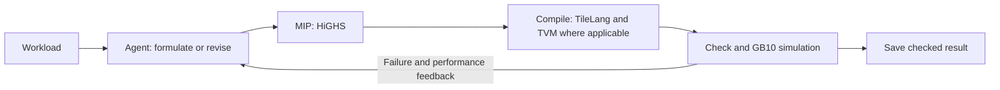

# Build an Agentic AI Infrastructure Optimizer

**Individual assignment · Due Friday, October 23, 2026, 23:59 (Beijing time, UTC+8) · 20 minutes per workload**

**Submit an executable optimization system.** Given a workload and model access, your system must use an Agent to formulate and debug a MIP, use HiGHS to select implementations, and produce a checked TileLang-based solution for GB10.

## 1. Required system capabilities

Your system must:

1. **Use Agent + MIP formulation as the main search method.** The Agent must construct or revise decision variables, domains, constraints, and a cost objective. Use **HiGHS** to solve the resulting MIP.
2. **Generate executable implementations.** Solver-selected decisions must control the actual TileLang program or graph configuration. Support changing the formulation and implementation in response to feedback.
3. **Run the evaluation loop automatically.** Compile candidates, test numerical correctness against an independent reference, invoke the GB10 simulator where supported, and use the feedback to continue searching or debugging without human intervention.
4. **Optimize the prescribed workload.** Preserve its input/output semantics and precision requirements. For a graph or network case, return and evaluate the complete prescribed computation and state sequence.
5. **Support the model-configuration interface.** Accept the documented configuration file and adapt it to your harness without source edits. You may choose your own models, providers, API accounts, and subscriptions.
6. **Run from a self-contained workspace.** Include the prompts, skills, MCP services, knowledge, code, and dependency specifications your system uses. Do not depend on undeclared user-level resources.
7. **Return a reproducible result within 20 minutes.** Save the generated implementation, its configuration, formulation, solver results, checking/evaluation evidence, and search records.
8. **Support new cases through the same interface.** Read the supplied workload definition and perform optimization without case-specific manual code edits.

Build around Agent + MIP, and explore how TVM graph optimization and SMT-assisted reasoning contribute to the system. Use them for concrete decisions or checks where applicable, and explain their scope, outcome, and any integration left incomplete. You may use multiple kernel families, multiple agents, retained experience, and autonomous harness improvements. Declare what is prebuilt and what changes during a run. TileLang is required for optimized GPU kernels.



### Using TVM, SMT, and solver results

- **TVM — graph-level choices.** For multi-operator workloads, use graph compilation to explore transformations, fusion and partitioning, then optimize selected regions with TileLang. Let the Agent revise these choices. Show the graph/partition change and the implementation it produced. For a single GEMM, discuss where graph optimization applies; a separate network importer or a mandatory two-operator demo is not expected in this assignment.
- **SMT — useful, scoped reasoning.** Use a solver such as Z3 to check properties that matter to your formulation, such as constraint consistency, index bounds or a small pipeline/event model. Feed counterexamples back into the formulation. State the property, assumptions, parameter domain and code version; a focused proof or counterexample is useful without proving every generated kernel family. Numerical testing remains required.
- **HiGHS — search and candidate selection.** Seek a good feasible solution and improve the objective/gap within the budget. Save the solver status, incumbent, available bound and gap. An optimal solver result is optimal only within the stated formulation and cost model. Select and evaluate a useful set of candidates to examine cost-model errors and revise the formulation; you choose its size and selection strategy. There is no fixed top-k requirement or requirement to finish every solve with proven optimality.

## 2. Required execution interface

Provide this non-interactive entry point:

```sh
./run.sh --workload /cases/example/workload.json \
  --model-config /evaluation/model.json \
  --output /results/example
```

Support these three arguments: the case specification, model configuration, and output directory. Resolve accompanying case files relative to the case directory. When `--model-config` is supplied, use it for that invocation. When it is omitted, you may use your harness's native authentication or subscription. Do not hardcode settings that prevent configuration-file operation.

Write the following outputs under the selected output directory:

| Output | Required content |
| --- | --- |
| `result.json` | Case ID; status (`checked`, `no_valid_result`, or `error`); final implementation entry and configuration; check/evaluation references; elapsed time and model/tool usage. |
| `implementation/` | Generated TileLang code, graph assembly, and supporting files needed to reproduce the result. |
| `formulations/` | Decision domains, constraints and cost definitions; exported LP/MPS; selected assignments; solver status and gap. |
| `trace.jsonl` | Agent actions, tool calls/results, failures, revisions and their supporting evidence, and resource consumption. |
| `state/` | Saved workspace state or changes needed to reproduce retained experience and harness self-improvement. |

The final result must identify the exact program and configuration that were checked and evaluated. Keep predictions, simulator evaluations, correctness results, and proof claims distinguishable. Record unsuccessful attempts as well as successful ones. Mark unavailable usage counts as `null`. Paths in `result.json` are relative to the output directory and must stay within it. Use milliseconds for `elapsed_ms` and explicitly label the units and source of performance values. `checked` means your numerical tests passed for this exact implementation against an independent reference; it does not assert optimality or a full-family proof. Implement these tests yourself, for example using PyTorch for GEMM reference values. Save the test method, representative input patterns/seeds, tolerances and observed errors. Identify the tested program/configuration and development hardware; no course-provided checker is required.

Minimum `result.json` format (additional fields are allowed):

```json
{
  "schema_version": "agentic-result-v1",
  "workload_id": "gemm_prefill",
  "status": "checked",
  "implementation": {"path": "implementation/kernel.py", "factory": "build", "config": {}},
  "evidence": {"correctness": "checks.json", "evaluation": "evaluation.json"},
  "elapsed_ms": 90000,
  "usage": {"model_calls": 4, "input_tokens": null, "output_tokens": null, "evaluations": 2}
}
```

For `no_valid_result` or `error`, set `implementation` to `null`, retain any available evidence, and add a short `reason`. Evaluation records must identify the implementation version or hash, evaluation source, value and unit. Never present simulator output as hardware measurement. Write UTF-8 JSON/JSONL; keep every tool record tied to its input/output artifacts. Return exit code 0 for `checked` or `no_valid_result`, and nonzero for an execution error. Checkpoint the best checked result before the deadline; do not rely on a final model call to save it.

## 3. Workload contract

Workload inputs use `workload.json`. A case may additionally supply a semantic reference and a parameterized TileLang starting implementation in this layout:

```text
case/
  workload.json    # Tensor specifications, precision, evaluation scope, defaults
  reference.py     # Independent reference computation, normally in PyTorch
  baseline.py      # Runnable parameterized TileLang starting implementation
  README.md        # Computation, parameter meanings, invocation and known limits
```

The computation interfaces are:

```python
# reference.py
# run(inputs: dict) -> outputs: dict

def run(inputs: dict) -> dict:
    ...

# baseline.py and the generated implementation
# build returns a callable: run(inputs: dict) -> outputs: dict

def build(workload: dict, config: dict):
    ...
```

`workload.json` is a UTF-8 JSON object with `id`, `inputs`, `outputs`, `accumulation_dtype`, `tolerance`, `evaluation`, and `baseline_config` (empty when no starting implementation is supplied), as shown in the downloadable example. Input/output objects are keyed by tensor name; each tensor has `shape` and `dtype`. The evaluator supplies tensor data to the callable; the JSON describes the computation and does not embed test tensors. Case-specific files are resolved from the directory containing `workload.json`.

Tensor names, shapes, dtypes, accumulation precision, and tolerances are specified by the case. Generate inputs and compare outputs against an independent reference yourself. Graph/network cases will also specify graph code, weights and state updates or prefill/decode sequences; check and report the complete prescribed workload.

You may change or replace the baseline, add kernel families, change graph partitions, and generate new code while preserving the case contract. Construct your own search domains, MIP constraints, and cost model. A general importer for arbitrary model formats is not required.

### GEMM inputs and GB10 simulator

Download [GB10 simulator + GEMM inputs](/agentic-optimizer/downloads/gb10-simulator-inputs-v2.zip). The GEMM shapes come from AI-Infra-Co-Design's existing `runs/gb10/shapes` cases:

| M | N | K |
| ---: | ---: | ---: |
| 32 | 4096 | 4096 |
| 128 | 4096 | 4096 |
| 2048 | 2048 | 2048 |
| 4096 | 4096 | 1024 |
| 4096 | 4096 | 4096 |

The package contains workload JSON inputs, the current SASS instruction-level simulator source, GB10 parameters, and a simulation-input example. It contains no Agent harness, optimization solutions, or saved timing results. Source commit: `a628c9d963cf9c029fa596b872d6e8920ca883e8`.

Compile your candidate for GB10 (`sm_121a`), export encoded SASS, and supply its actual configuration/resource metadata:

```sh
nvdisasm -hex kernel.cubin > examples/kernel.sass
python3 simulate.py --input examples/simulation-input.json --output prediction.json
```

The simulator runs on CPU with Python 3.10+ and standard-library dependencies. Its input is compiled SASS plus shape/configuration metadata; M/N/K alone is insufficient. This is timing simulation for the upstream cp.async/TMA GEMM paths and does not check output values. See the short package README for fields. The current model has known limitations: record unsupported mappings, errors, timeouts, known resource-invalid configurations and incomplete simulations separately, and exclude such values from performance comparisons. Save simulation status independently of numerical correctness. Predictions are model estimates; examining their limitations is part of the assignment. Other operators/network cases and final evaluation details will follow.

## 4. Model and harness requirements

- **Model choice:** unrestricted. API accounts, native harness logins, and subscriptions are allowed. Record the model and access mode used.
- **Recommended harnesses:** Codex, Claude Code, pi, or OpenCode. If you use another harness, explain the choice and how to reproduce it.
- **Versioning:** specify and pin the CLI/SDK and other software versions you require.
- **Configuration compatibility:** translate the file below into the settings required by your harness. Declare supported protocols and necessary model capabilities. Supporting this interface does not require you to use it for every development run.

```json
{
  "protocol": "openai_responses",
  "base_url": "https://model-endpoint.example/v1",
  "model": "evaluation-model",
  "api_key_env": "EVAL_MODEL_API_KEY"
}
```

Recognized protocol identifiers are `openai_responses`, `openai_chat_completions`, and `anthropic_messages`. In configuration-file mode, read the credential from the named environment variable and honor the specified endpoint and model. Report unsupported configurations clearly. Supply authentication separately at runtime; do not include secrets in source, submissions, or logs.

## 5. Workspace and runtime rules

- **Clean environment:** do not inherit undeclared user-level skills, MCP servers, plugins, global agent instructions, personal memory, or conversation history. Package all required resources in the submitted workspace and record what was loaded. Runtime authentication for your chosen model or subscription is allowed.
- **Offline operation:** connections needed for the selected model service and its authentication are allowed. Web browsing/search, external resource retrieval, and dependency downloads are disabled during the timed run. Prepare tools and local documentation beforehand.
- **Time limit:** each workload has **20 minutes of wall-clock time**, starting when the environment and model access are ready and the workload is supplied. Model calls, solving, compilation, checking, simulation, and debugging count toward this time. Parallel work shares the same budget.
- **Iterations:** unlimited within the time budget. You may reuse sessions and workspace memory, and let the system revise its prompts, strategies, formulations, or code. Preserve the changes needed to reproduce this evolution.
- **Timeout:** checkpoint useful results during the run. Return the best implementation that passed your numerical tests; select it using usable evaluation evidence. If none passed, report `no_valid_result` and retain the failure records.
- **Token use:** no fixed token cap in this draft. Record available input, output, cached, and reasoning-token usage, including retries and subagents, plus model-call and evaluation counts. Efficiency will be considered; scoring details remain pending.
- **Development hardware:** other NVIDIA GPUs may be used for testing. Identify that hardware and keep its measurements separate from GB10 simulator results.
- **Evaluation integrity:** preserve the supplied simulator and parameter version used for evaluation, do not fabricate evidence or substitute fixed test outputs for computation. Record any diagnostic model experiments separately. Exhaustively evaluating a space and encoding its known winner as a MIP does not satisfy the required search method.

## 6. What to submit

Upload one **ZIP**, with the project files directly at the archive root (no enclosing directory). Include `run.sh`, `README.md`, and `report.md` at the root. Put saved case runs under `results/<workload-id>/`, using the output layout in Section 2. Other source/resource directories may be organized freely; document their locations in `README.md`. Do not include credentials, virtual environments, package caches, or model weights that the case package already supplies.

The upload limit is **256 MiB compressed and 1 GiB expanded**, with at most 10,000 archive entries. Use relative paths, no symbolic links, and an unencrypted ZIP. Include:

1. **`run.sh` and the optimizer source**, including the model-configuration adapter.
2. **A workspace** with all required prompts, skills, MCP configuration/services, local knowledge, and other resources.
3. **A pinned dependency manifest and setup instructions**, with the required harness version and supported model protocols.
4. **Saved outputs from the public cases**, using the output layout in Section 2; identify incomplete or failed runs.
5. **A short report** stating what the Agent formulated, what feedback changed it, the results and resource use, and remaining limitations. Disclose prewritten components and sources. Scope any SMT/full-family proof by its assumptions, parameter domain, and program version.

The entry point must execute the complete optimization process without manual intervention. Your system may adapt and improve autonomously within the per-workload budget. The complete workload is evaluated through the course protocol.

**Submission portal:** [Upload your project](http://10.204.87.113:8005/). Enter your name and student ID and upload the ZIP. This portal only checks archive safety and the three required root files, stores the artifact, and issues a private receipt with its SHA-256. It does not execute code, judge correctness, or assign a score. Keep the receipt key or download the receipt JSON; it is needed to retrieve your upload. A later upload creates a new submission and preserves earlier versions. **Submission deadline: Friday, October 23, 2026, 23:59 (Beijing time, UTC+8).**

## 7. Assessment criteria

Assessment will use the following dimensions. **Weights, thresholds, and the final scoring formula remain under discussion.**

| Dimension | Evidence to provide |
| --- | --- |
| End-to-end system | A reproducible workload-to-implementation run with actual solver, checking, and simulator results. |
| Formulation quality | Meaningful source-bound decisions; consistent domains and constraints; justified cost assumptions; solver status and gap. |
| Feedback-driven improvement | A trace showing which observation led the Agent to change the code, formulation, or search strategy, and what happened afterward. |
| Verification and evaluation | Correctness evidence, version-bound results, clear proof scope where used, and honest reporting of failures or unsupported cases. |
| Performance and efficiency | Improvement over an initial numerically correct implementation, and a supplied baseline if available, under the same protocol; include elapsed time, token usage, and compilation/simulation counts. |
| Report and reproducibility | A concise explanation supported by saved artifacts, including what did not work and what remains uncertain. |

In your report, include one trace: **workload → formulation → HiGHS choice → generated implementation → evaluation feedback → next decision**. Explain the modeled search space and justified exclusions, how well selected points performed, and any important prediction/evaluation disagreement. Report the initial and final implementation identities and distinguish simulated estimates from measurements on development hardware. No fixed latency or cuBLAS-relative performance threshold is set in this draft. A clear, economical system with sound evidence is valuable even when performance does not improve.

## 8. Details to be announced

The extracted GB10 simulator source and parameters from [AI-Infra-Co-Design](https://github.com/memxlife/AI-Infra-Co-Design) are available above. The compilation toolchain, other cases, and **grading weights and detailed scoring rules** will be published separately.
